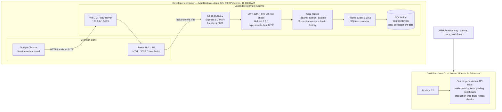
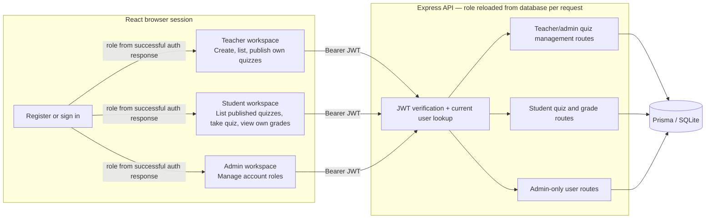

# Detailed Architecture and Environment

This diagram and inventory describe the checked-in implementation and the environment observed while preparing this repository on 19 November 2026. It is a local-development architecture. No public deployment or production server has been configured.

## Hardware and software deployment view

The browser talks to the React/Vite development server. Vite proxies `/api` requests to Express on port 3001. Express applies authentication and current-role authorization before routing quiz operations to Prisma. Prisma reads and writes a local SQLite database. In production, Vite would normally serve a built static frontend, but no such host or production infrastructure is configured in this project.

## Runtime, hardware, and dependency inventory

Versions below are the versions observed in the local checkout on 19 November 2026; JavaScript package versions are resolved from `package-lock.json`, not inferred from the looser ranges in package manifests.

| Layer | Component | Observed version / configuration |
| --- | --- | --- |
| Developer hardware | Laptop | MacBook Air, Apple M5, 10 CPU cores (4 performance + 6 efficiency), 16 GB memory |
| Developer OS | macOS | 26.6.2; arm64 |
| JavaScript runtime | Node.js | 26.5.0; V8 14.6.202.34-node.24; OpenSSL 3.6.5 |
| Package manager | npm | 11.17.0 |
| Frontend runtime | React / React DOM | 19.3.1 / 19.3.1 |
| Frontend development/build | Vite / React plugin | 7.3.7 / 5.2.0 |
| Backend runtime | Express | 5.3.0 |
| ORM and generated client | Prisma CLI / `@prisma/client` | 6.19.3 / 6.19.3 |
| Database | SQLite | Local file at `app/api/dev.db`; SQLite engine version is not separately pinned in the repository |
| Authentication | `jsonwebtoken` / `bcryptjs` | 9.0.3 / 3.0.3 |
| API security middleware | Helmet / `express-rate-limit` | 8.3.0 / 8.7.2 |
| API tests | Supertest / Node test runner | Supertest 7.3.1; Node built-in test runner on the selected Node runtime |
| Browser | Google Chrome | Used to view the app; exact browser build was not captured |
| Web development endpoint | Vite | `http://localhost:5173` (port may increment if occupied) |
| API development endpoint | Express | `http://localhost:3001`; Vite proxies `/api` to this endpoint |
| Test database | SQLite | `app/api/.env.test` points to a separate local test database; tests should not use `dev.db` |
| CI operating system | GitHub Actions | `ubuntu-24.04`, Node.js 22 as configured in workflows |
| Hosting / production hardware | Not configured | No cloud host, server size, public database, or production URL is claimed |

The developer hardware row records the machine used to prepare the local project. It is not a minimum or production hardware requirement. The repository does not define a production deployment target. API TLS support is available when both certificate and key paths are configured, but live TLS termination has not been demonstrated.

## Application boundaries and role access

Public account registration always creates a `student`. A teacher account is provisioned separately with the seed command or promoted by an administrator. The API reads the current role from the database on each authenticated request, so a changed role takes effect even when an older token is still held by the browser. A student cannot create or manage quizzes; a teacher can create and manage their own quizzes but cannot access grade-history or admin-user endpoints.

## Randomized quiz presentation

When a student starts a quiz, the API independently shuffles the question list and each question's options with a cryptographically secure Fisher–Yates shuffle. The randomized order is returned for that attempt only; stored quiz order is unchanged. Stable question IDs and option text travel with the shuffled presentation, so submitted answers still map to the correct answer on the server. Correct-answer fields are never included in the student response. Randomization is independent for each start; chance can still produce matching orders for two students.

## Configuration and trust boundaries

- `app/api/.env` contains the local SQLite URL, JWT secret, API port, and optional private admin seed settings; it is ignored by Git.
- `app/api/.env.test` contains test-only configuration and must remain isolated from development data.
- Browser requests use bearer JWTs; authorization decisions are server-side.
- The student API response intentionally omits answer keys. Grading compares submitted answers to the server-side database values.
- Local Vite/Express HTTP is for development. TLS 1.2+ is supported by the API's optional HTTPS configuration; production certificate deployment and PostgreSQL are not present.
- GitHub Actions runs on GitHub-hosted Ubuntu 24.04 with Node.js 22. It does not specify or promise a fixed CPU or memory allocation.
