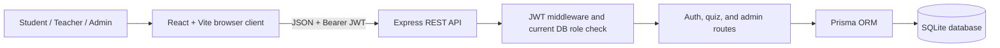
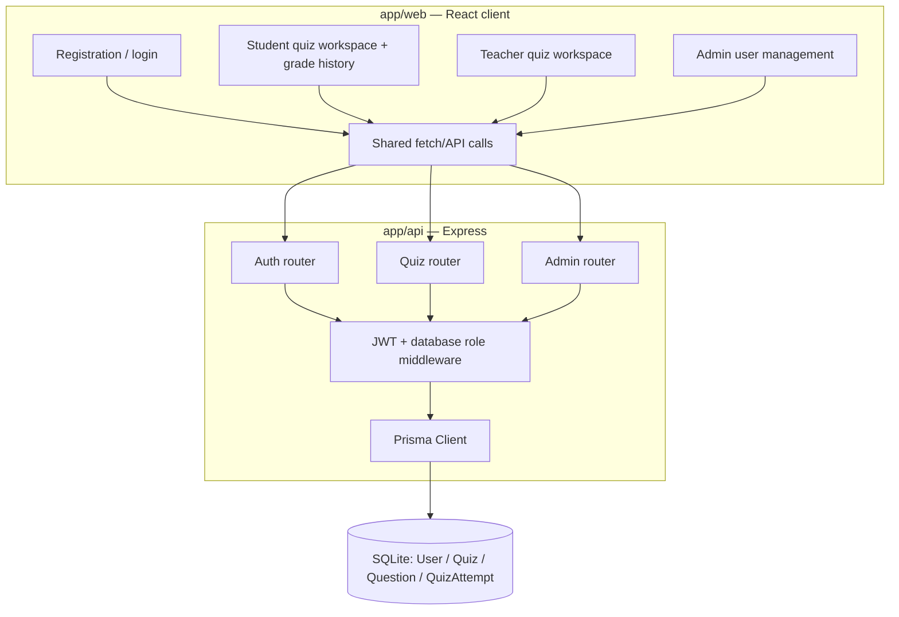
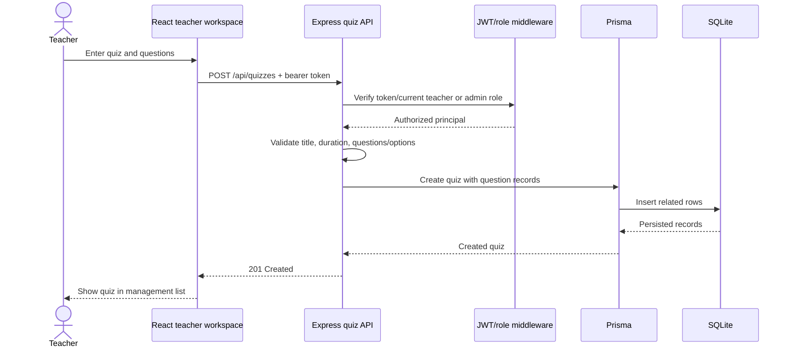
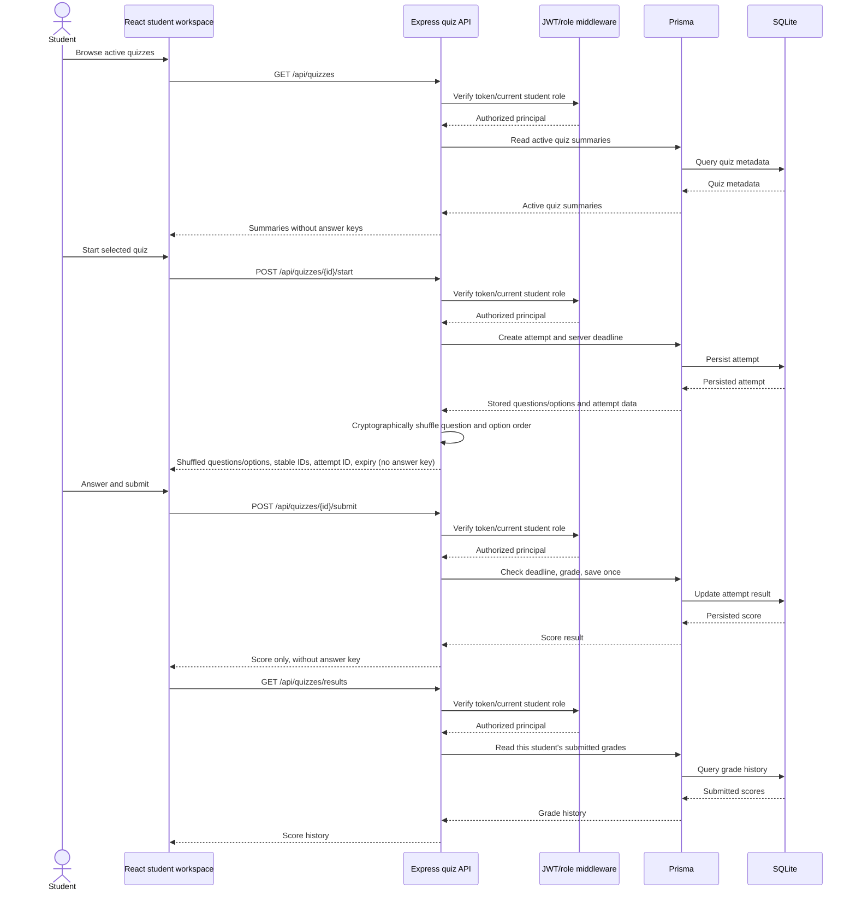
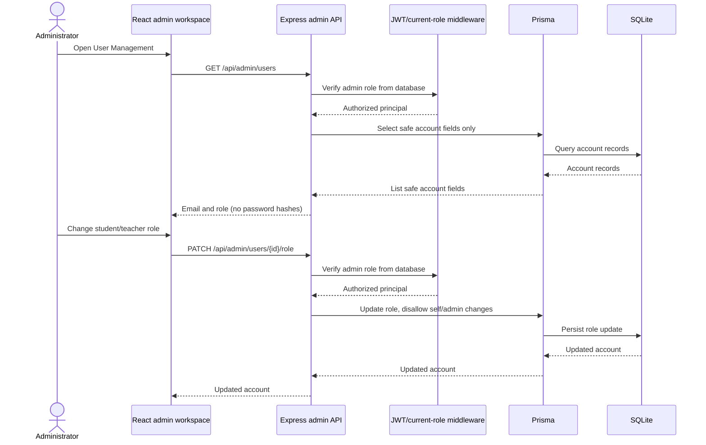

# Rendered Architecture and Interaction Diagrams

These Mermaid figures are based on the checked-in source as of 19 November 2026 and render directly in GitHub. Editable PlantUML source files remain alongside them. The use-case diagram in PlantUML is not a MUL export.

## System architecture

## Component view

## Teacher creates a quiz

## Student completes a timed attempt

## Admin manages accounts

For deviations and unimplemented deployment evidence, see the [RTM and deviation log](../3-Requirements-Engineering/).

For a versioned hardware/software inventory, detailed deployment topology, role trust boundaries, and configuration notes, see the [detailed architecture and environment](deployment-architecture.md).
